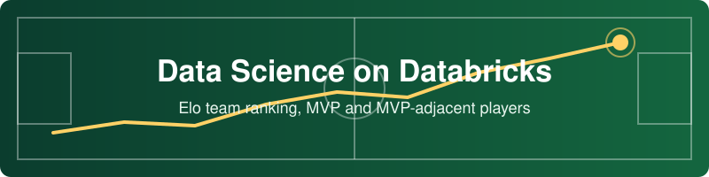

# Data Science on Databricks

<p align="center">
  <a href="https://ds500.paiml.com" title="Pragmatic AI Labs">
    
  </a>
</p>

[](https://github.com/paiml/databricks-data-science/actions/workflows/ci.yml)
[](https://www.python.org/downloads/)
[](LICENSE)
[](#dataset-and-licence)

<p align="center">
  <strong>One dataset, five courses: find the MVP, find the MVP-adjacent, rank every team with Elo</strong><br>
  Databricks | Statistics | Data Science | Python | SQL
</p>

Demo repository for the **Data Science on Databricks** specialization on Coursera. Every course uses the same data
and the same two answers, in Python and in SQL, so the two sets of numbers must match.

## Courses

| # | Course | Notebook |
|---|--------|----------|
| 1 | Databricks From Zero | `notebooks/course1_databricks_from_zero.py` |
| 2 | Statistics From Zero | `notebooks/course2_statistics_from_zero.py` |
| 3 | Data Science From Zero | `notebooks/course3_data_science_from_zero.py` |
| 4 | Sports Analytics on Databricks in Python | `notebooks/course4_sports_analytics_python.py` |
| 5 | Sports Analytics on Databricks in SQL | `notebooks/course5_sports_analytics_sql.sql` |

## Quick start

```bash
make install        # pip install -e ".[dev]"
make gate           # lint, mypy, tests with 100% line and branch coverage
dbx-ds elo          # top 10 teams on the committed fixture
dbx-ds mvp          # MVP and MVP-adjacent players per season
```

The repo ships a small fixture (two Premier League seasons, 760 matches, `data/fixture/*.parquet`, about 125 KB), so
everything runs with no download. For all 11 leagues:

```bash
make data           # downloads database.sqlite (sha256 checked), writes data/parquet/*.parquet
```

## Dataset and licence

- **Name:** European Soccer Database, by Hugo Mathien (Kaggle `hugomathien/soccer`): 25,979 matches, 11,060 players,
  299 teams, 11 European leagues, seasons 2008/2009 to 2015/2016. Seven tables: Country, League, Match, Player,
  Player_Attributes, Team, Team_Attributes.
- **Licence:** "Database: Open Database, Contents: (c) Original Authors", that is the Open Data Commons Open Database
  License (ODbL) 1.0: <http://opendatacommons.org/licenses/odbl/1.0/>. Source of the licence statement: the dataset
  page <https://www.kaggle.com/datasets/hugomathien/soccer> (its structured metadata, read 2026-11-23).
- **Notice shipped with the data:** `data/fixture/NOTICE.txt` (written by `dbx-ds fixture`, ODbL section 4.2(b)) carries
  the licence name and URL and the attribution; keep it with any copy of the fixture.
- **Fixture ratings are synthetic:** `Player_Attributes.overall_rating` in `data/fixture/` is a deterministic synthetic
  integer, `50 + ((id * 7919 + 104729) % 41)`, not the real FIFA value (those are EA Sports contents). So fixture
  MVPs are illustrative of the method, not of real players. Real ratings come only from `make data`.
- **Rights in the contents:** the ODbL covers the database only. Match results, odds and player ratings remain (c) their
  original authors (football-data.co.uk, EA Sports FIFA via sofifa.com). This repo claims no rights in them.
- **Attribution:** data by Hugo Mathien via Kaggle; the Kaggle page lists the underlying sources (football-data.co.uk
  for results and odds, sofifa.com for the FIFA player and team attributes, football-data.mx-api.enetscores.com for
  match events). Contents remain (c) their original authors.
- **What this repo redistributes:** the fixture is a derived database (a subset of Country, League, Match, Team,
  Player and Player_Attributes). Under the ODbL it stays under the ODbL (share-alike) and carries this attribution.
  The code in this repo is Apache-2.0. The full file is never committed.
- **Where `make data` gets the file:** Kaggle needs credentials, so we download a credential-free mirror of the
  identical file and pin its hash:
  - URL: <https://huggingface.co/datasets/julien-c/kaggle-hugomathien-soccer/resolve/main/database.sqlite>
  - sha256: `4df8569777d59fdd690754b1cc8ca1f7989baf65f2eaddd0f1368285f11139a9` (313,090,048 bytes)
  - The mirror's own README states `license: odbl` and names the Kaggle page as its source. Its table set and row
    counts match the Kaggle description. We could not compare it byte for byte with Kaggle's copy without a Kaggle
    login; the hash pin means a changed file fails loudly.

## Elo team ranking

`src/dbx_ds/elo.py`, `sql/elo.sql`. Every team starts at 1500. Matches replay in order of date, then
`match_api_id`. The home side gets +100 points when we work out who was expected to win. A win scores 1, a draw
0.5, a loss 0. The rating moves by `K * (actual - expected)` with `K = 20`. Ratings carry across seasons. The
constants are named at the top of the file and checked against the SQL by a test.

## MVP and MVP-adjacent

`src/dbx_ds/mvp.py`, `sql/mvp.sql`. Per player per season:

```
score = 0.7 * rating + 0.3 * win_share
```

- `rating`: the player's newest `overall_rating` (0 to 100) inside the season (1 August to 31 July).
- `win_share`: league points the team won while the player started, as a percent of the 3 points per match possible.
- Only players with at least 10 starts count. "Started" means named in the 11 lineup slots of the Match table.
- **MVP:** rank 1 on `score`.
- **MVP-adjacent:** top 20 on `score`, not the MVP, and either under-rated (the `overall_rating` rank is 10 or more
  places worse than the score rank) or a part-timer (15 starts or fewer). High value, quietly so.

## Python and SQL agree

`tests/test_parity.py` runs `sql/elo.sql` and `sql/mvp.sql` on the fixture with DuckDB and asserts the output equals
the Python output (ratings to 1e-9, ranks and flags exactly); `tests/test_c5_sql.py` and `tests/test_same_day.py` do the
same for `sql/elo_dbx.sql` and the Course 5 views, including a team playing twice on one date.

**Not yet run on Databricks SQL itself.** The SQL is verified on DuckDB only. A
SQLite parity run is not possible: SQLite refuses window functions in the recursive step that `sql/elo_dbx.sql` and the
`elo_state` view need, and has no MAP for `sql/elo.sql`. Before the first Databricks run, raise its recursion-depth limit
to cover the number of replay steps (`max(day)` of `elo_sides`), then run `sql/demo_parity.sql` against Python tables written to the
warehouse. See `CHANGELOG.md`.

## Databricks Free Edition: upload path

1. `make data` on your laptop (or use `data/fixture/` to start small).
2. In Databricks: Catalog, your schema, Create, Volume (for example `main.default.soccer`).
3. Upload `data/parquet/*.parquet` (or `data/fixture/*.parquet` **and `data/fixture/NOTICE.txt`**: the ODbL notice travels with every copy) to the Volume.
4. Add this repo as a Git folder, open a notebook from `notebooks/`, set `DBX_DS_DATA=/Volumes/main/default/soccer`.
5. For Course 5, run the first cell, which makes temp views over the Volume files; the Elo and MVP SQL then run as is.

## Project structure

```
src/dbx_ds/    elo.py, mvp.py, data.py, queries.py, cli.py
sql/           elo.sql, mvp.sql (DuckDB-verified)
notebooks/     one Databricks-importable notebook per course
data/fixture/  committed Parquet fixture (ODbL)
tests/         100% line and branch coverage, SQL/Python parity
assets/        banner.svg
```

## Quality gates

`make gate` runs `ruff`, `mypy --strict` and `pytest` with `fail_under = 100` on line and branch coverage. CI
(`ci / gate`) runs the same on pinned versions. There are no advisory or report-only checks.

## License

Code: Apache-2.0 (see [LICENSE](LICENSE)). Data: ODbL 1.0, contents (c) original authors (see above).

## Demo code for courses 1 to 5

Each lesson demo the scripts narrate lives in the package; the notebooks only call it.

| Course | Notebook | Code | SQL twin (course 5) |
|---|---|---|---|
| 1 Databricks from zero | `notebooks/course1_databricks_from_zero.py` | `sqldemo`, `report` | `sql/demo_course1.sql` |
| 2 Statistics from zero | `notebooks/course2_statistics_from_zero.py` | `course2`, `stats`, `load`, `changelog` | `sql/demo_stats.sql` |
| 3 Data science from zero | `notebooks/course3_data_science_from_zero.py` | `course3`, `features`, `models` | `sql/demo_features.sql` |
| 4 Sports analytics (Python) | `notebooks/course4_sports_analytics_python.py` | `course4`, `eloplus`, `mvpplus` | `sql/demo_elo.sql`, `sql/demo_mvp.sql` |
| 5 Sports analytics (SQL) | `notebooks/course5_sports_analytics_sql.sql` | `sql/elo_dbx.sql`, `sql/c5_views.sql` | the views plus the two demo files, `sql/demo_parity.sql` |

Seeds are fixed (`course2.SIMULATION_SEED`, `course2.RESAMPLE_SEED`). Tests check Python against SQL on a seeded
synthetic database (`tests/synth.py`). Numbers from the full database are in `tests/test_full_data.py`
(marker `full_data`, skipped without `make data`; run `pytest -m full_data`).

### Courses 4 and 5: decisions to know about

- **Elo without MAP.** `sql/elo_dbx.sql` replays one match day per recursion step with one state row per (parameter set,
  team), so it is about 1,700 steps (plus one per extra same-day match of a repeat team) instead of 26,000 and has no MAP, no LATERAL and no DuckDB-only call. It equals
  `eloplus.replay` to 1e-9. A date on which no team plays twice is one step; a date on which some team does is replayed one match per
  step in `match_api_id` order, the same tiebreak as `elo.py` (`tests/test_same_day.py` checks it on a double-header case). On the full database it took 6.3 s on `intel`, against 443.5 s for `sql/elo.sql`.
- **Per-league MVP.** `mvpplus.score_leagues` ranks inside each league-season, so a player's starts are counted per league.
  The all-league numbers the scripts quote (2199 to 3003 qualified players, Messi 89.35) still come from `queries.python_mvp`;
  the per-league counts differ a little (2202 to 3032) because a player in two leagues is counted in each.
- **Position** is taken from the lineup slot (slot 1 GK, 2-5 DEF, 6-8 MID, 9-11 FWD; the group he started in most, per player-season).
  **z-score** is taken inside the position group of one league-season (population standard deviation; shown as 50 + 10 z).
- **Elo-adjusted win share** is `50 + 100 * mean(actual - expected)` over the player's starts, with the pre-match Elo forecast (home bonus included) as expected.
- **Standings check** orders by points, goal difference, goals for, team id; Spearman is `1 - 6 sum(d^2) / (n (n^2 - 1))` on those ranks.
- **Python against SQL.** `src/dbx_ds/course4.py` writes `py_elo` and `py_mvp`; `sql/demo_parity.sql` counts differing rows (0).
  The views are plain `TEMP VIEW`s: on the full database make them tables first, as each query re-runs the recursion.
- **Not run on Databricks.** Everything is verified on DuckDB only (fixture, a seeded multi-league database, and the full database
  on `intel`). The recursion-depth limit of Databricks SQL must cover the number of replay steps (`max(day)` of `elo_sides`) before the Elo is run on the full data.
- Full-database numbers: `tests/test_full_data_c45.py`. The c3 baseline log loss check is `course3.baseline_log_losses`.

